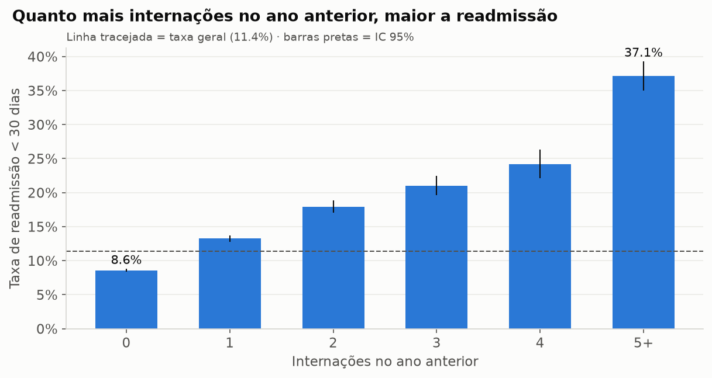
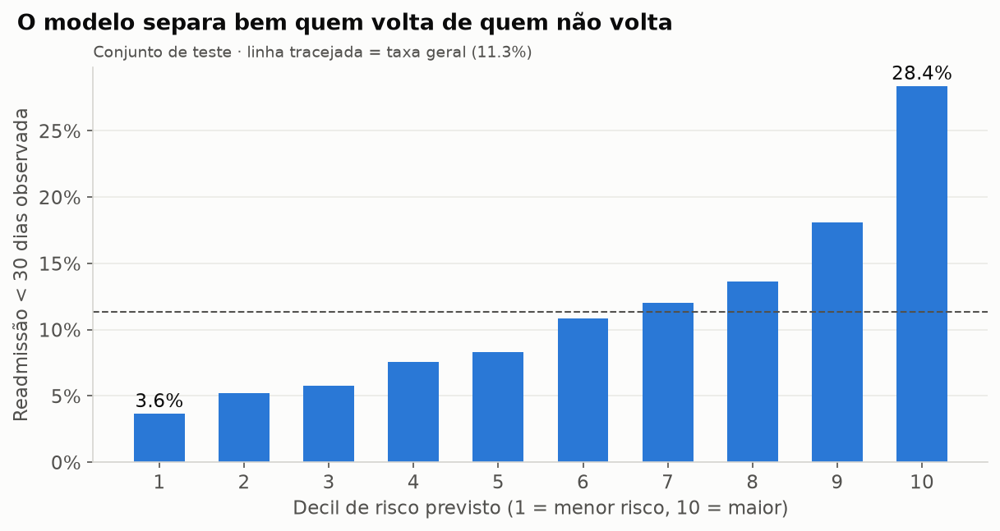
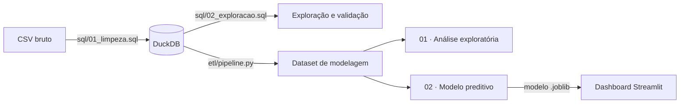

# Readmissão hospitalar de pacientes diabéticos — dos dados à prevenção

Projeto completo de dados, do dataset bruto até um dashboard de apoio à decisão, para responder a uma pergunta clínica:

> **Quais pacientes diabéticos têm maior chance de voltar ao hospital em até 30 dias após a alta — e o que a equipe de enfermagem poderia fazer a respeito?**

O projeto combina **engenharia e ciência de dados** (SQL, ETL em Python, Machine Learning, dashboard) com **interpretação clínica de enfermagem**: cada achado vira uma hipótese assistencial e uma proposta de protocolo com indicadores de acompanhamento.


---

## Principais resultados

| | |
|---|---|
| **Fator mais forte** | Readmissão de **8,6%** sem internações no ano anterior, contra **37,1%** com 5 ou mais |
| **Destino da alta** | **9,3%** de readmissão na alta para casa, contra **27,7%** no encaminhamento para reabilitação |
| **HbA1c** | Não foi registrada em **83%** das internações. Quem fez o exame teve um pouco menos de readmissão |
| **Modelo** (gradient boosting) | ROC-AUC **0,686** e PR-AUC **0,243** em pacientes nunca vistos no treino |
| **Uso prático** | Os **20% de maior risco** concentram **41%** das readmissões. No decil mais alto, **28,4%** voltam; no mais baixo, **3,6%** |

<p align="center">
  
  
</p>

**Da análise à prática:** os achados deram origem a quatro propostas de protocolo, cada uma com objetivo, etapas e indicadores, fundamentadas na Política Nacional de Atenção Hospitalar e nas diretrizes da Sociedade Brasileira de Diabetes:

1. Identificação e acompanhamento de pacientes com internações recorrentes
2. Rastreamento e monitoramento glicêmico hospitalar
3. Alta segura e educação em saúde para pacientes com diabetes
4. Transição do cuidado após a alta

Os protocolos completos estão na seção 8 de [`01_analise_exploratoria.ipynb`](notebooks/01_analise_exploratoria.ipynb).

---

## Os dados

**Diabetes 130-US Hospitals for Years 1999–2008** ([UCI Machine Learning Repository](https://archive.ics.uci.edu/dataset/296/diabetes+130-us+hospitals+for+years+1999-2008)): 101.766 internações de pacientes diabéticos em 130 hospitais americanos. Cada linha é uma internação, com dados demográficos, diagnósticos (CID-9), exames, medicamentos, histórico de utilização do serviço e o desfecho de readmissão.

Depois da limpeza: **99.340 internações elegíveis** de **69.987 pacientes**. Óbitos e encaminhamentos para hospice foram removidos, porque esses pacientes não têm como ser readmitidos. A taxa de readmissão em menos de 30 dias é de **11,4%**.

## Pipeline



| Etapa | O que faz |
|---|---|
| [`sql/01_limpeza.sql`](sql/01_limpeza.sql) | Carrega o CSV no DuckDB, converte `?` em nulo e separa as 3 tabelas de domínio que vêm empilhadas no mesmo arquivo |
| [`sql/02_exploracao.sql`](sql/02_exploracao.sql) | Qualidade dos dados (nulos, valores inválidos, colunas constantes) e taxa de readmissão por fator |
| [`etl/pipeline.py`](etl/pipeline.py) | Remove internações não elegíveis, cria o alvo, agrupa os CID-9 por sistema, trata nulos e cria variáveis de histórico. Valida o resultado antes de salvar |
| [`notebooks/01_analise_exploratoria.ipynb`](notebooks/01_analise_exploratoria.ipynb) | Taxas por fator com intervalo de confiança, discussão clínica, protocolos e referências |
| [`notebooks/02_modelo.ipynb`](notebooks/02_modelo.ipynb) | Comparação de modelos, estratificação de risco, interpretação e aplicação assistencial |
| [`app/app.py`](app/app.py) | Dashboard: calcula o risco de uma internação e mostra os principais achados |

## Decisões de método

- **Treino e teste separados por paciente.** 16 mil pacientes aparecem em mais de uma internação. Se o mesmo paciente caísse nos dois lados, o modelo o "reconheceria" e a métrica ficaria otimista. A separação foi feita por paciente, com uma verificação automática no código.
- **Métricas para classes desbalanceadas.** Com 11% de positivos, um modelo que sempre responde "não volta" acerta 89% e não serve para nada. Por isso a avaliação usa ROC-AUC, PR-AUC, sensibilidade e precisão, e os modelos são treinados com pesos balanceados.
- **Comparação com uma base aleatória.** Regressão logística (interpretável) e gradient boosting foram comparados com um classificador aleatório, usando validação cruzada em 5 partes agrupadas por paciente.
- **Ponto de corte com sentido assistencial.** "Alto risco" corresponde aos 20% de maior escore, um volume plausível para uma intervenção de enfermagem na alta.
- **Incerteza visível.** Os gráficos da análise exploratória mostram intervalos de confiança de 95%, para não tirar conclusões de grupos pequenos.

## Como rodar

Requer Python 3.12 ou mais recente e o [DuckDB CLI](https://duckdb.org/docs/installation/).

```bash
git clone https://github.com/leticiamendes-data/diabetes-readmission.git
cd diabetes-readmission
python3 -m venv venv
./venv/bin/pip install -r requirements.txt
```

```bash
# 1. Banco e exploração em SQL
duckdb data-processed/diabetes.duckdb < sql/01_limpeza.sql
duckdb data-processed/diabetes.duckdb < sql/02_exploracao.sql

# 2. ETL
./venv/bin/python etl/pipeline.py

# 3. Notebooks (análise e modelo — o segundo salva o modelo usado pelo dashboard)
./venv/bin/jupyter nbconvert --to notebook --execute --inplace --ExecutePreprocessor.timeout=1200 notebooks/*.ipynb

# 4. Dashboard
./venv/bin/streamlit run app/app.py
```

Para abrir só o dashboard, basta o passo 4: o modelo treinado já está em `models/`.

## Estrutura

```
diabetes-readmission/
├── data-raw/              dataset original (sem alterações)
├── data-processed/        banco DuckDB e datasets gerados (não versionados)
├── sql/                   carga e exploração em SQL
├── etl/                   pipeline ETL e rótulos em português
├── notebooks/             análise exploratória e modelo
├── models/                modelo treinado (.joblib)
├── app/                   dashboard Streamlit
├── reports/figures/       gráficos usados no README e no dashboard
└── requirements.txt
```

## Limitações

- **Dados históricos (1999–2008) de hospitais dos EUA.** Os padrões podem não refletir a prática atual nem a população brasileira. O modelo precisaria ser revalidado em dados locais antes de qualquer uso real.
- **Variáveis ausentes.** A base não tem dados sociais, funcionais, de adesão nem de cuidado pós-alta. Isso explica boa parte do desempenho moderado.
- **Associação não é causa.** Os achados indicam quem tem maior chance de voltar, não por quê. As propostas são hipóteses a serem avaliadas.
- **Escore não calibrado.** O escore ordena o risco, mas não é a probabilidade real de readmissão.

## Próximos passos

- Calibrar as probabilidades e avaliar o desempenho por subgrupos (raça, gênero, idade), em busca de vieses
- Publicar o dashboard online (Streamlit Community Cloud)
- Automatizar o pipeline na nuvem: armazenamento no AWS S3 e processamento com AWS Lambda
- Validar com dados mais recentes, incluindo datas, comorbidades e informações pós-alta

## Referências principais

- Strack, B. et al. *Impact of HbA1c measurement on hospital readmission rates: analysis of 70,000 clinical database patient records.* BioMed Research International, 2014. DOI: [10.1155/2014/781670](https://doi.org/10.1155/2014/781670)
- Brasil. Ministério da Saúde. *Política Nacional de Atenção Hospitalar* (Portaria nº 3.390/2013; Portaria de Consolidação nº 2/2017, Anexo XXIV)
- Sociedade Brasileira de Diabetes. *Manejo da hiperglicemia hospitalar em pacientes não críticos* e *Diretrizes clínicas para implantação de programa de controle glicêmico hospitalar* (2025)
- American Diabetes Association. *Standards of Care in Diabetes—2026*, seção 16: Diabetes Care in the Hospital

A lista completa está na seção 9 da [análise exploratória](notebooks/01_analise_exploratoria.ipynb).

## Autora

**Leticia Mendes**: projeto de portfólio que une a experiência clínica em enfermagem à engenharia e à ciência de dados.

> As propostas de protocolos são recomendações para discussão e desenvolvimento institucional. Não substituem protocolos clínicos vigentes, avaliação multiprofissional ou decisões individualizadas de assistência. O dashboard é um projeto de portfólio e não deve ser usado para decisões clínicas reais.
