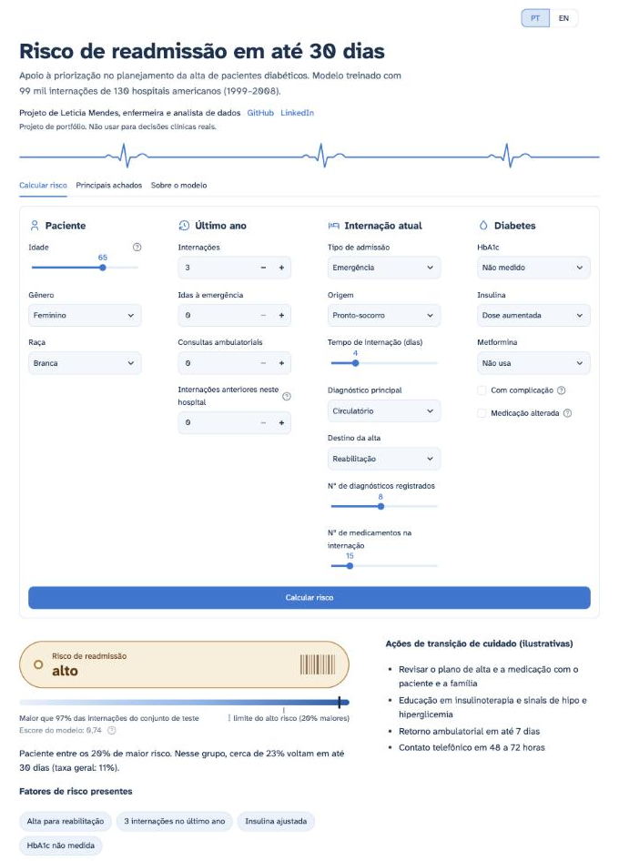
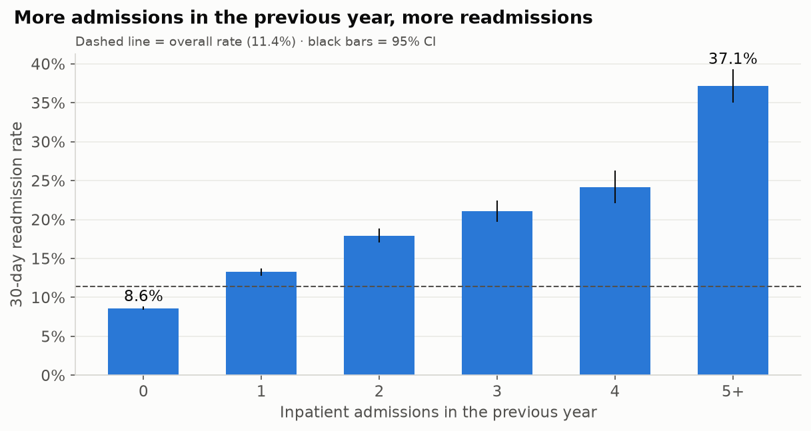
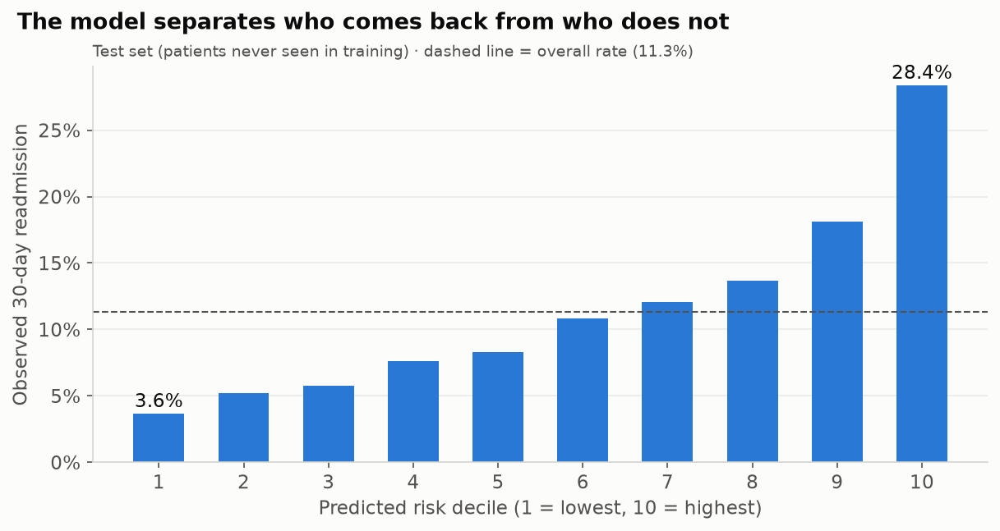
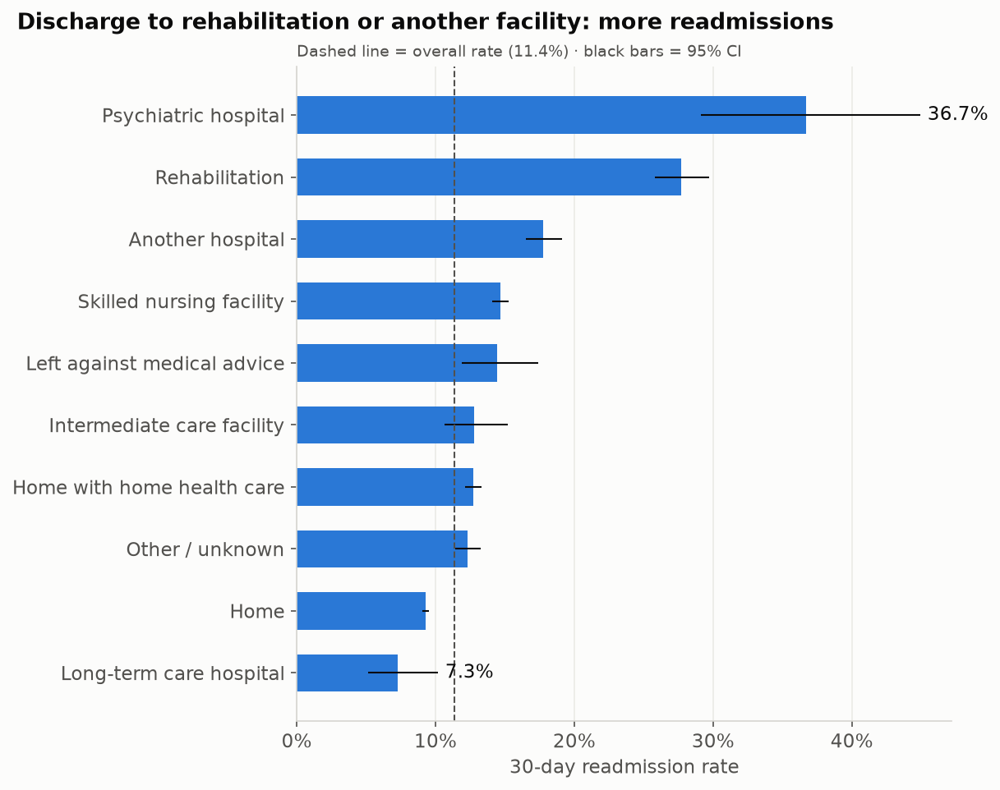
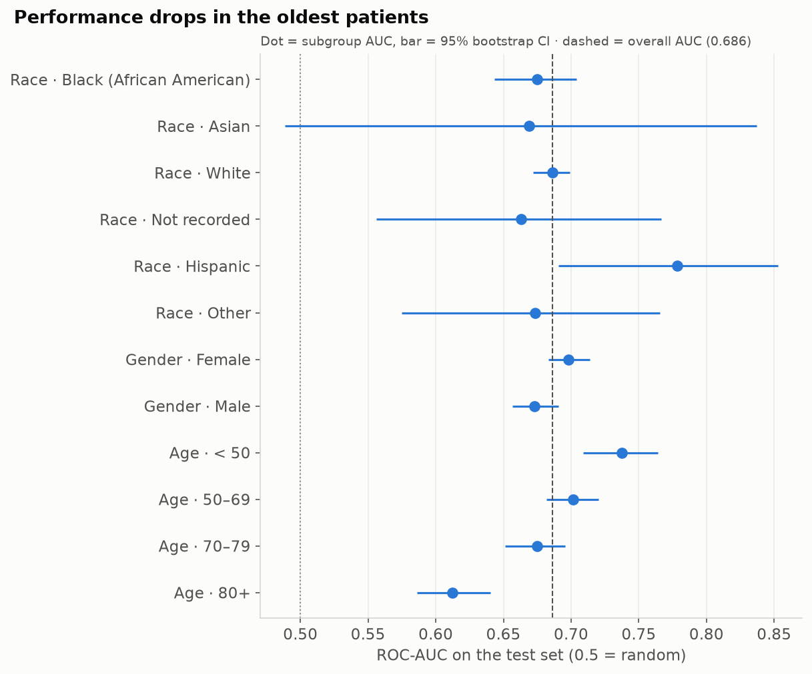
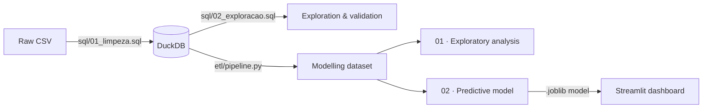

# Hospital readmission in patients with diabetes — from data to prevention

🇧🇷 [Versão em português](README.pt-BR.md)

An end-to-end data project, from a raw clinical dataset to a decision-support dashboard, built around one clinical question:

> **Which patients with diabetes are most likely to be readmitted within 30 days of discharge — and what could the nursing team do about it?**

The project combines **data engineering and data science** (SQL, a Python ETL pipeline, machine learning and a dashboard) with **clinical nursing interpretation**. Each finding becomes a care hypothesis and a proposed protocol with monitoring indicators.


<sub>The dashboard: enter the details of an admission and get a risk tier, the patient's position among test-set admissions, and the risk factors present. The interface is in Portuguese.</sub>

---

## Key results

| | |
|---|---|
| **Strongest factor** | Readmission rises from **8.6%** (no admissions in the previous year) to **37.1%** (five or more) |
| **Discharge destination** | **9.3%** readmission when discharged home vs **27.7%** when discharged to rehabilitation |
| **HbA1c** | Not recorded in **83%** of admissions. Patients who had the test were readmitted slightly less often |
| **Model** (gradient boosting) | ROC-AUC **0.686** and PR-AUC **0.243** on patients never seen during training |
| **Practical value** | The **top 20%** by risk score account for **41%** of all readmissions. In the highest decile **28.4%** are readmitted, vs **3.6%** in the lowest |
| **Fairness check** | Similar performance across race and gender, but lower for patients **aged 80+** (AUC 0.61). This led to a proposed complementary functional assessment for this group |

<p align="center">
  
  
</p>
<p align="center">
  
  
</p>

**From analysis to practice:** the findings led to four proposed care protocols, each with objectives, steps and indicators. They are grounded in Brazil's National Hospital Care Policy (PNHOSP), the Brazilian Diabetes Society guidelines and the American Diabetes Association Standards of Care:

1. Identifying and following up patients with recurrent admissions
2. In-hospital glucose screening and monitoring
3. Safe discharge and health education for patients with diabetes
4. Transition of care after discharge

## The data

**Diabetes 130-US Hospitals for Years 1999–2008** ([UCI Machine Learning Repository](https://archive.ics.uci.edu/dataset/296/diabetes+130-us+hospitals+for+years+1999-2008)). It has 101,766 admissions of patients with diabetes across 130 US hospitals. Each row is one admission, with demographics, diagnoses (ICD-9), lab tests, medications, prior healthcare use and the readmission outcome.

After cleaning there are **99,340 eligible admissions** from **69,987 patients**. Deaths and discharges to hospice were removed, because these patients cannot be readmitted. The 30-day readmission rate is **11.4%**.

## Pipeline



| Step | What it does |
|---|---|
| [`sql/01_limpeza.sql`](sql/01_limpeza.sql) | Loads the CSV into DuckDB, converts `?` to null and splits the three lookup tables that come stacked in a single file |
| [`sql/02_exploracao.sql`](sql/02_exploracao.sql) | Data quality checks (nulls, invalid values, constant columns) and readmission rates by factor |
| [`etl/pipeline.py`](etl/pipeline.py) | Removes ineligible admissions, creates the target, groups ICD-9 codes by body system, handles nulls and builds history features. Validates the output before saving |
| [`notebooks/01_analise_exploratoria.ipynb`](notebooks/01_analise_exploratoria.ipynb) | Rates by factor with confidence intervals, clinical discussion, care protocols and references |
| [`notebooks/02_modelo.ipynb`](notebooks/02_modelo.ipynb) | Model comparison, risk stratification, interpretation, subgroup analysis and clinical application |
| [`app/app.py`](app/app.py) | Dashboard: scores an admission and shows the key findings |

> The notebooks and the dashboard are written in Portuguese. Each notebook opens with an executive summary.

## Methodological choices

- **Train/test split by patient.** About 16,000 patients have more than one admission. If the same patient appeared in both sets, the model could "recognise" them and the metrics would be optimistic. The split is grouped by patient, and the code checks automatically that no patient appears on both sides.
- **Metrics suited to class imbalance.** With 11% positives, a model that always predicts "no readmission" is 89% accurate and useless. Models are evaluated with ROC-AUC, PR-AUC, sensitivity and precision, and trained with balanced class weights.
- **Baseline comparison.** Logistic regression (interpretable) and gradient boosting are compared against a random classifier, with 5-fold cross-validation grouped by patient.
- **A clinically meaningful threshold.** "High risk" means the top 20% of scores, a realistic workload for a nursing intervention at discharge.
- **Visible uncertainty.** Exploratory charts show 95% confidence intervals, and subgroup AUCs show bootstrap intervals, so that small groups don't lead to firm conclusions.

## How to run

Requires Python 3.12 or newer.

```bash
git clone https://github.com/leticiamendes-data/diabetes-readmission.git
cd diabetes-readmission
make setup   # create the virtual environment and install dependencies
make all     # database -> ETL -> notebooks -> figures (about 1 minute)
make app     # open the dashboard
```

`make help` lists each step. To open just the dashboard, run `make setup` and `make app`: the trained model is already in `models/`.

## Project structure

```
diabetes-readmission/
├── data-raw/              original dataset (unchanged)
├── data-processed/        DuckDB database and generated datasets (not versioned)
├── sql/                   loading and exploration in SQL
├── etl/                   ETL pipeline and Portuguese labels
├── notebooks/             exploratory analysis and model
├── models/                trained model (.joblib)
├── app/                   Streamlit dashboard
├── reports/               charts (Portuguese and English) and the README figures script
├── Makefile               full pipeline in one command
└── requirements.txt
```

## Limitations

- **Historical data (1999–2008) from US hospitals.** Patterns may not reflect current practice or other populations. The model would need local revalidation before any real-world use.
- **Missing variables.** There are no social, functional, adherence or post-discharge data, which explains much of the moderate performance.
- **Association is not causation.** The findings show who is more likely to come back, not why. The proposed interventions are hypotheses to be evaluated.
- **Uncalibrated score.** The score ranks risk but is not the actual probability of readmission.
- **Weaker performance in older patients.** For patients aged 80+, the score is less able to identify who will be readmitted.

## Next steps

- Calibrate probabilities and test functional and social variables to improve performance in older patients
- Deploy the dashboard online (Streamlit Community Cloud)
- Move the pipeline to the cloud (AWS S3 for storage, AWS Lambda for processing)
- Validate on more recent data with dates, comorbidities and post-discharge information

## Main references

- Strack, B. et al. *Impact of HbA1c measurement on hospital readmission rates: analysis of 70,000 clinical database patient records.* BioMed Research International, 2014. DOI: [10.1155/2014/781670](https://doi.org/10.1155/2014/781670)
- American Diabetes Association. *Standards of Care in Diabetes—2026*, Section 16: Diabetes Care in the Hospital
- Sociedade Brasileira de Diabetes. Guidelines on in-hospital hyperglycaemia management and hospital glycaemic control programmes (2025)
- Brazil, Ministry of Health. *National Hospital Care Policy (PNHOSP)*, Ordinance No. 3,390/2013

The full reference list is in section 9 of the [exploratory analysis](notebooks/01_analise_exploratoria.ipynb).

## Author

**Leticia Mendes**: a portfolio project bringing clinical nursing experience together with data engineering and data science.

> The proposed protocols are recommendations for discussion and institutional development. They do not replace current clinical protocols, multidisciplinary assessment or individualised care decisions. The dashboard is a portfolio project and must not be used for real clinical decisions.
